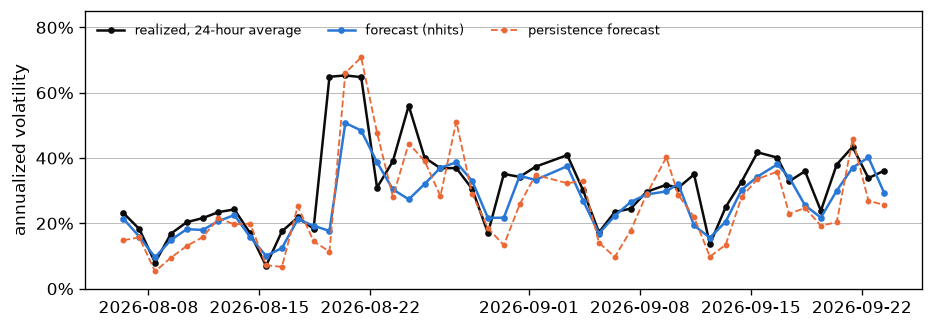

# Daily record (generated)

Forecast days scored: 51. Resolved rows: 9720. Pending (logged, outcome not yet observed): 192.

Every row from an earlier run was committed to git before its target hour completed, except the forecast day listed below. Each run audits every earlier commit of the forecast log, so a day's rows are checked on the run after the one that committed them. The commit history is the timestamp evidence.

- The 2026-09-03 forecast, made from data through the hour starting 10:00 UTC (8 models), was first committed at 2026-09-04 05:15 UTC, 17 hours after its first target hour completed.

| model                |   days |   pinball_mean |    mae |   cov50 |   cov90 |   skill_vs_persistence |   day_error |   day_skill |
|:---------------------|-------:|---------------:|-------:|--------:|--------:|-----------------------:|------------:|------------:|
| nhits                |     48 |         0.1029 | 0.3207 |  0.4939 |  0.901  |                 0.2248 |      0.1892 |      0.4047 |
| gbm                  |     51 |         0.1097 | 0.3382 |  0.4453 |  0.8382 |                 0.1793 |      0.1997 |      0.3505 |
| sarima               |     51 |         0.1139 | 0.3497 |  0.5719 |  0.9101 |                 0.1486 |      0.2045 |      0.3348 |
| har_seasonal         |     51 |         0.1236 | 0.3868 |  0.4567 |  0.8685 |                 0.0741 |      0.2587 |      0.1586 |
| har                  |     51 |         0.1268 | 0.3972 |  0.4853 |  0.8717 |                 0.0622 |      0.2695 |      0.1237 |
| persistence          |     51 |         0.1366 | 0.4245 |  0.5392 |  0.9126 |                 0      |      0.3075 |      0      |
| prophet              |     51 |         0.1376 | 0.4133 |  0.4649 |  0.8056 |                -0.0451 |      0.3451 |     -0.1224 |
| seasonal_persistence |     51 |         0.1568 | 0.4811 |  0.4755 |  0.8685 |                -0.184  |      0.2984 |      0.0298 |

The hourly columns score each of the 24 target hours. The day columns score the day's average volatility, which could be one input to a position size. day_error is the mean absolute log error of the 24 hourly median forecasts' average against the realized average, over fully resolved days, so lower is better. day_skill is one minus the ratio of that error to the persistence model's on the same days, so a positive value beats persistence and 1 would be a perfect forecast.

The days column is each model's own count of scored days. Models that joined the loop later are averaged over fewer days, so the rows above are not sample-matched.

Matched on the 48 fully resolved days that both nhits and persistence forecast, the skill of nhits over persistence is 0.26 on the hourly pinball loss (95% interval 0.16 to 0.35) and 0.40 on the day-level error (0.18 to 0.63). Pinball loss scores the whole low-to-high forecast band, not just its middle, and lower is better. The hourly figure pools the loss over those days, while the table's skill_vs_persistence averages the 24 per-hour skills, each model over its own days. Each interval comes from the day-to-day spread of the gap between the two models' daily scores and treats each day as independent of the last. An interval that stays above zero means that, on these days, the lead over persistence is larger than day-to-day noise would explain.

The figure below is that day-level record for nhits, the current leader: its forecast of each day's average volatility, the average that realized, and the persistence model's own forecast of the same average.

The calibration check passes, with no model's day-level 90% coverage separable from 0.90 by more than sampling noise. The test is two-sided on each model's daily coverage against 0.90 over 51 scored days, Bonferroni-corrected across the 8 models tested (per-model alpha 0.0063).

