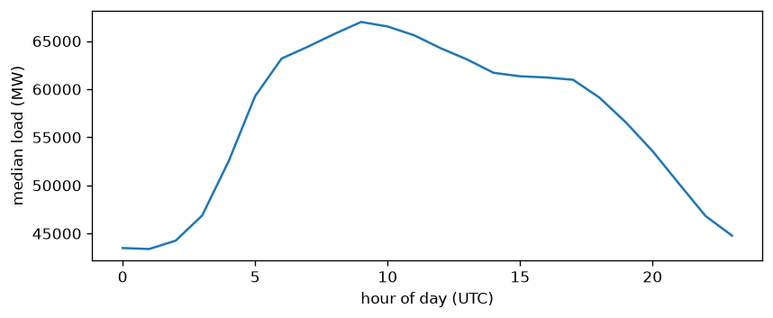
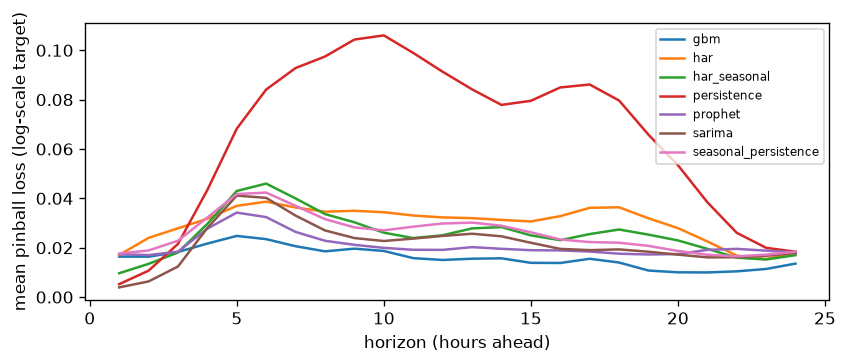

# Generality demo: German hourly load (OPSD/ENTSO-E, CC-BY 4.0) (generated)

Results file: load_backtest_DE.parquet. All metrics are on the log scale of the target. Coverage targets: cov50 -> 0.50, cov90 -> 0.90. skill_vs_persistence is the mean of per-horizon skill scores, so a model can rank differently on skill than on pinball_mean; horizons where persistence does worst weigh most.

## Dataset
- hours: 50400, span 2015-01-01 00:00:00+00:00 to 2020-09-30 23:00:00+00:00
- NaN target hours (data gaps, excluded from training and scoring): 0

## Leaderboard, mean over horizons 1-24

| model                |   pinball_mean |    mae |   cov50 |   cov90 |   skill_vs_persistence |
|:---------------------|---------------:|-------:|--------:|--------:|-----------------------:|
| gbm                  |         0.016  | 0.0467 |  0.4642 |  0.8492 |                 0.5353 |
| prophet              |         0.0208 | 0.0641 |  0.4574 |  0.8546 |                 0.4269 |
| sarima               |         0.0217 | 0.0645 |  0.5104 |  0.8356 |                 0.5721 |
| har_seasonal         |         0.0255 | 0.0837 |  0.4805 |  0.9022 |                 0.4511 |
| seasonal_persistence |         0.0258 | 0.0736 |  0.5358 |  0.9262 |                 0.3588 |
| har                  |         0.0298 | 0.1006 |  0.6241 |  0.966  |                 0.2895 |
| persistence          |         0.0641 | 0.2295 |  0.2794 |  0.7962 |                 0      |

## Horizon 1

| model                |   pinball_mean |    mae |   rmse |   cov50 |   cov90 |   n |   skill_vs_persistence |
|:---------------------|---------------:|-------:|-------:|--------:|--------:|----:|-----------------------:|
| sarima               |         0.0039 | 0.0118 | 0.0166 |  0.6304 |  0.9565 |  92 |                 0.2502 |
| persistence          |         0.0052 | 0.0105 | 0.0126 |  0.9565 |  1      |  92 |                 0      |
| har_seasonal         |         0.0097 | 0.0266 | 0.0316 |  0.5978 |  1      |  92 |                -0.8442 |
| gbm                  |         0.0164 | 0.046  | 0.0592 |  0.4891 |  0.8696 |  92 |                -2.1318 |
| har                  |         0.0171 | 0.0637 | 0.0665 |  0.4239 |  1      |  92 |                -2.2595 |
| prophet              |         0.0174 | 0.0516 | 0.0734 |  0.6196 |  0.8696 |  92 |                -2.3179 |
| seasonal_persistence |         0.0176 | 0.0481 | 0.0616 |  0.5    |  1      |  92 |                -2.3646 |

## Horizon 24

| model                |   pinball_mean |    mae |   rmse |   cov50 |   cov90 |   n |   skill_vs_persistence |
|:---------------------|---------------:|-------:|-------:|--------:|--------:|----:|-----------------------:|
| gbm                  |         0.0136 | 0.0343 | 0.0459 |  0.5652 |  0.837  |  92 |                 0.2613 |
| har_seasonal         |         0.017  | 0.0539 | 0.066  |  0.7283 |  1      |  92 |                 0.0748 |
| sarima               |         0.0178 | 0.0476 | 0.0636 |  0.75   |  0.9891 |  92 |                 0.0289 |
| prophet              |         0.0181 | 0.0559 | 0.0751 |  0.5217 |  0.8478 |  92 |                 0.0144 |
| har                  |         0.0182 | 0.0561 | 0.0681 |  0.6739 |  0.9783 |  92 |                 0.0097 |
| persistence          |         0.0184 | 0.051  | 0.0656 |  0.4783 |  1      |  92 |                 0      |
| seasonal_persistence |         0.0184 | 0.051  | 0.0656 |  0.4783 |  1      |  92 |                 0      |

The identical persistence and seasonal_persistence rows at horizon 24 are by construction: there the seasonal lag is the same last observed hour, and both bands draw on the same 24-hour change distribution.

Backtest origins all sit at 00:00 UTC, so a given horizon always lands on the same UTC clock hour, and the pinball-by-horizon curve inherits the hour-of-day profile above (correlation 0.92 between the two curves on this run). A bump at one horizon is largely that clock hour showing through, not a property of forecasting that far ahead.
