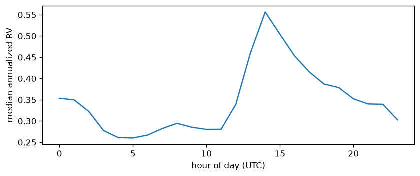
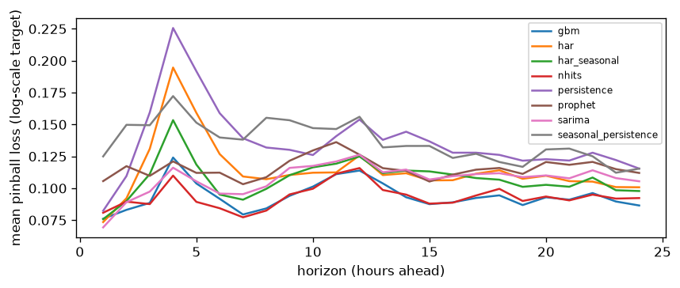

# Backtest report (generated)

Results file: backtest_20261022.parquet. All metrics are on the log scale of the target. Coverage targets: cov50 -> 0.50, cov90 -> 0.90. skill_vs_persistence is the mean of per-horizon skill scores, so a model can rank differently on skill than on pinball_mean; horizons where persistence does worst weigh most.

## Dataset
- hours: 26412, span 2023-08-01 00:00:00+00:00 to 2026-08-05 11:00:00+00:00
- NaN target hours (data gaps, excluded from training and scoring): 18

## Results table, mean over horizons 1-24

| model                |   pinball_mean |    mae |   cov50 |   cov90 |   skill_vs_persistence |
|:---------------------|---------------:|-------:|--------:|--------:|-----------------------:|
| nhits                |         0.0934 | 0.2918 |  0.4952 |  0.8982 |                 0.2977 |
| gbm                  |         0.0939 | 0.2902 |  0.4287 |  0.8468 |                 0.2988 |
| sarima               |         0.1071 | 0.3323 |  0.5553 |  0.9012 |                 0.1975 |
| har_seasonal         |         0.1075 | 0.3397 |  0.4963 |  0.8894 |                 0.2017 |
| har                  |         0.1143 | 0.3654 |  0.5076 |  0.8933 |                 0.1616 |
| prophet              |         0.1157 | 0.3617 |  0.4952 |  0.8727 |                 0.1256 |
| persistence          |         0.1368 | 0.4321 |  0.5269 |  0.9064 |                 0      |
| seasonal_persistence |         0.1369 | 0.4231 |  0.5065 |  0.8966 |                -0.0246 |

## Horizon 1

| model                |   pinball_mean |    mae |   rmse |   cov50 |   cov90 |   n |   skill_vs_persistence |
|:---------------------|---------------:|-------:|-------:|--------:|--------:|----:|-----------------------:|
| sarima               |         0.0693 | 0.2155 | 0.2954 |  0.5902 |  0.9399 | 183 |                 0.1579 |
| har                  |         0.0735 | 0.2314 | 0.3077 |  0.4835 |  0.8846 | 182 |                 0.1072 |
| har_seasonal         |         0.0757 | 0.24   | 0.311  |  0.456  |  0.8681 | 182 |                 0.08   |
| gbm                  |         0.0761 | 0.2369 | 0.3051 |  0.377  |  0.8634 | 183 |                 0.0753 |
| nhits                |         0.0808 | 0.2536 | 0.317  |  0.4426 |  0.8798 | 183 |                 0.0183 |
| persistence          |         0.0823 | 0.2566 | 0.3463 |  0.5027 |  0.929  | 183 |                 0      |
| prophet              |         0.1056 | 0.3397 | 0.43   |  0.5137 |  0.8962 | 183 |                -0.283  |
| seasonal_persistence |         0.125  | 0.3904 | 0.5083 |  0.5519 |  0.929  | 183 |                -0.5182 |

## Horizon 24

| model                |   pinball_mean |    mae |   rmse |   cov50 |   cov90 |   n |   skill_vs_persistence |
|:---------------------|---------------:|-------:|-------:|--------:|--------:|----:|-----------------------:|
| gbm                  |         0.0865 | 0.2665 | 0.3468 |  0.4153 |  0.8743 | 183 |                 0.2505 |
| nhits                |         0.0923 | 0.2875 | 0.3795 |  0.5246 |  0.9235 | 183 |                 0.2001 |
| har_seasonal         |         0.0978 | 0.2971 | 0.4019 |  0.5604 |  0.9286 | 182 |                 0.1523 |
| har                  |         0.1008 | 0.3075 | 0.4119 |  0.5659 |  0.9176 | 182 |                 0.1268 |
| sarima               |         0.1055 | 0.3192 | 0.429  |  0.6011 |  0.9235 | 183 |                 0.0862 |
| prophet              |         0.112  | 0.3363 | 0.4661 |  0.5355 |  0.9016 | 183 |                 0.0294 |
| persistence          |         0.1154 | 0.3472 | 0.4709 |  0.5574 |  0.929  | 183 |                 0      |
| seasonal_persistence |         0.1154 | 0.3472 | 0.4709 |  0.5574 |  0.929  | 183 |                 0      |

The identical persistence and seasonal_persistence rows at horizon 24 are by construction: there the seasonal lag is the same last observed hour, and both bands draw on the same 24-hour change distribution.

Where a model's n falls short of the maximum, rows whose forecast came back NaN (a degenerate fit) were dropped before scoring, so per-model samples differ slightly there.

Backtest origins all sit at 10:00 UTC, so a given horizon always lands on the same UTC clock hour, and the pinball-by-horizon curve inherits the hour-of-day profile above (correlation 0.65 between the two curves on this run). A bump at one horizon is largely that clock hour showing through, not a property of forecasting that far ahead.
