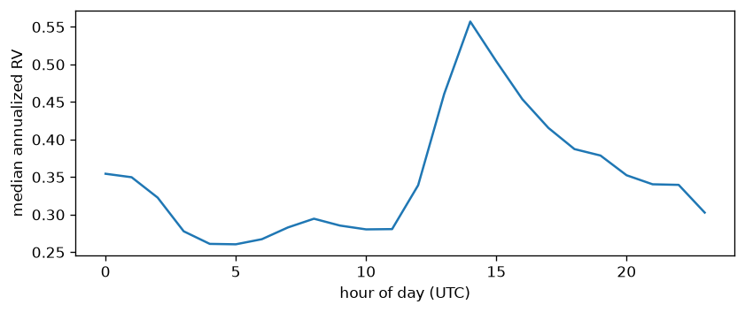
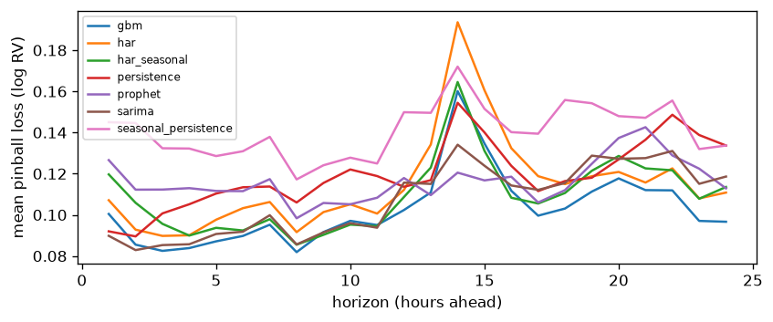

# Tournament report (generated)

Results file: backtest_20260805.parquet. All metrics are on the log scale of the target. Coverage targets: cov50 -> 0.50, cov90 -> 0.90. skill_vs_persistence is the mean of per-horizon skill scores, so a model can rank differently on skill than on pinball_mean; horizons where persistence does worst weigh most.

## Dataset
- hours: 26412, span 2023-08-01 00:00:00+00:00 to 2026-08-05 11:00:00+00:00
- NaN target hours (data gaps, excluded from training and scoring): 19

## Results table, mean over horizons 1-24

| model                |   pinball_mean |    mae |   cov50 |   cov90 |   skill_vs_persistence |
|:---------------------|---------------:|-------:|--------:|--------:|-----------------------:|
| nhits                |         0.0959 | 0.3025 |  0.4958 |  0.9002 |                 0.1857 |
| gbm                  |         0.1021 | 0.3226 |  0.4867 |  0.8662 |                 0.1322 |
| sarima               |         0.1067 | 0.3323 |  0.5471 |  0.9113 |                 0.0952 |
| har_seasonal         |         0.1092 | 0.3482 |  0.4865 |  0.9022 |                 0.0688 |
| har                  |         0.1142 | 0.3642 |  0.5034 |  0.9004 |                 0.0315 |
| prophet              |         0.1165 | 0.361  |  0.4933 |  0.8552 |                -0.0011 |
| persistence          |         0.118  | 0.3672 |  0.5849 |  0.9437 |                 0      |
| seasonal_persistence |         0.1404 | 0.4339 |  0.4987 |  0.892  |                -0.2068 |

## Horizon 1

| model                |   pinball_mean |    mae |   rmse |   cov50 |   cov90 |   n |   skill_vs_persistence |
|:---------------------|---------------:|-------:|-------:|--------:|--------:|----:|-----------------------:|
| nhits                |         0.0847 | 0.2494 | 0.3768 |  0.5    |  0.8901 | 182 |                 0.0773 |
| sarima               |         0.0901 | 0.267  | 0.3869 |  0.5193 |  0.8674 | 181 |                 0.0187 |
| persistence          |         0.0918 | 0.2765 | 0.395  |  0.5    |  0.8736 | 182 |                 0      |
| gbm                  |         0.1009 | 0.3141 | 0.4372 |  0.456  |  0.8956 | 182 |                -0.0991 |
| har                  |         0.108  | 0.3431 | 0.4595 |  0.4231 |  0.8791 | 182 |                -0.1764 |
| har_seasonal         |         0.1206 | 0.3841 | 0.507  |  0.3846 |  0.8352 | 182 |                -0.3146 |
| prophet              |         0.1255 | 0.3779 | 0.5127 |  0.489  |  0.8407 | 182 |                -0.3681 |
| seasonal_persistence |         0.1451 | 0.4465 | 0.5953 |  0.5275 |  0.8681 | 182 |                -0.5816 |

## Horizon 24

| model                |   pinball_mean |    mae |   rmse |   cov50 |   cov90 |   n |   skill_vs_persistence |
|:---------------------|---------------:|-------:|-------:|--------:|--------:|----:|-----------------------:|
| gbm                  |         0.0966 | 0.3046 | 0.4097 |  0.541  |  0.918  | 183 |                 0.2745 |
| nhits                |         0.1036 | 0.3194 | 0.4521 |  0.5738 |  0.9126 | 183 |                 0.2219 |
| har                  |         0.1108 | 0.345  | 0.4614 |  0.5355 |  0.918  | 183 |                 0.1682 |
| har_seasonal         |         0.1135 | 0.3523 | 0.4712 |  0.4918 |  0.8962 | 183 |                 0.1475 |
| prophet              |         0.114  | 0.3502 | 0.4788 |  0.5137 |  0.8689 | 183 |                 0.1444 |
| sarima               |         0.1187 | 0.3637 | 0.4903 |  0.5879 |  0.9011 | 182 |                 0.1085 |
| persistence          |         0.1332 | 0.4139 | 0.5497 |  0.5246 |  0.9126 | 183 |                 0      |
| seasonal_persistence |         0.1332 | 0.4139 | 0.5497 |  0.5246 |  0.9126 | 183 |                 0      |

The identical persistence and seasonal_persistence rows at horizon 24 are by construction: there the seasonal lag is the same last observed hour, and both bands draw on the same 24-hour change distribution.

Where a model's n falls short of the maximum, rows whose forecast came back NaN (a degenerate fit) were dropped before scoring, so per-model samples differ slightly there.

Backtest origins all sit at 00:00 UTC, so a given horizon always lands on the same UTC clock hour, and the pinball-by-horizon curve inherits the hour-of-day profile above (correlation 0.79 between the two curves on this run). A bump at one horizon is largely that clock hour showing through, not a property of forecasting that far ahead.
